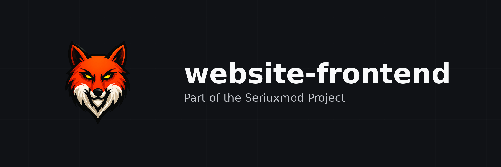

<p align="center">
  
</p>

# SeriuxMod Website Frontend

Dieses öffentliche Repository enthält die zentrale Weboberfläche von SeriuxMod. Die React-Anwendung verbindet Landingpage, öffentliche Spielerprofile, Forum, Community, Store, Systemstatus, Account-Sicherheit und den rollenbasierten Administrationsbereich in einer gemeinsamen Oberfläche.

## Funktionsbereiche

- Landingpage mit News-Slider und Launcher-Präsentation
- globale Spielersuche und 3D-Skinanzeige
- öffentliche SeriuxMod- und Minecraft-Profile
- Forum mit Boards, Themen, Beiträgen und Moderationsoberfläche
- Feedback-/Vorschlagsbereich und Social-Hub
- Store, Checkout, Käufe, Abrechnung und Shop-Administration
- OAuth2-Login, E-Mail-Verifikation, Passwort-Reset, Passkeys und Sitzungsverwaltung
- Systemstatus mit Serviceübersicht und Connection Flow
- Administration für Benutzer, Forum und Store

## Libraries und Versionen

| Library / Toolchain | Version | Verwendung |
| --- | --- | --- |
| React | `^18.3.1` | Komponenten und UI-State |
| React DOM | `^18.3.1` | Browser-Rendering |
| React Router DOM | `7.18.2` | clientseitiges Routing |
| React Icons | `^5.2.1` | Icons |
| skinview3d | `^3.4.1` | Minecraft-Skinmodell |
| Tailwind CSS | `^3.4.6` | Utility-CSS |
| PostCSS | `8.5.26` | CSS-Verarbeitung |
| Autoprefixer | `10.5.4` | Browser-Präfixe |
| Vite | `8.2.2` | Entwicklungsserver und Produktionsbuild |
| `@vitejs/plugin-react` | `6.1.0` | React-Integration für Vite |
| Prettier | `^3.3.3` | Formatierung |
| Prettier Tailwind Plugin | `^0.6.5` | Sortierung von Tailwind-Klassen |

Die exakten aufgelösten Versionen stehen in `package-lock.json`; die Tabelle bildet die direkten Angaben aus `package.json` ab.

## Lokale Entwicklung

Voraussetzung ist Node.js 22 oder neuer, passend zur GitHub-Pages-Pipeline.

```bash
npm ci
npm run dev
```

Produktionsbuild und lokale Vorschau:

```bash
npm run build
npm run preview
```

Mit `npm run format` werden die Dateien unter `src/` durch Prettier formatiert.

## Konfiguration

| Variable | Zweck |
| --- | --- |
| Identitäts-Transport | gRPC-Web über den öffentlichen TLS-Gateway; keine Browser-Geheimnisse |

Weitere Service-URLs und OAuth2-Einstellungen werden derzeit in den Dateien unter `src/lib/` geführt. Neue Geheimnisse dürfen nicht als `VITE_*`-Variable eingebunden werden, weil Vite diese Werte in den Browser-Build schreibt.

## Projektstruktur

```text
src/components/       globale Navigation, Suche, Presence und wiederverwendbare UI
src/components/admin/ Layout und Bausteine des Admin-Dashboards
src/pages/            Seiten für Home, Forum, Community, Store, Account und Status
src/lib/              Authentifizierung und API-Clients
src/config/           öffentliche Frontend-Konfiguration
```

## Deployment

Ein Push auf `main` löst `.github/workflows/deploy.yml` aus. Die Pipeline installiert mit `npm ci`, erzeugt den Vite-Build und veröffentlicht die Website über GitHub Pages.

Vor jedem Build laufen `npm test` (PKCE-Abschluss und Profil-Routing). Erst nach erfolgreichen Tests und Build veröffentlicht die Pipeline ausschließlich `dist/` im Branch `gh-pages`. GitHub Pages verwendet `gh-pages` mit Pfad `/`; Custom Domain ist `seriuxmod.net`, HTTPS bleibt aktiviert. `npm run build` erzeugt auch den SPA-404-Fallback, `CNAME` und `.nojekyll`.

## Profil- und Konto-URLs

- `/@<accountname>`: öffentliches Spielerprofil; Standardziel des Login-Buttons.
- `/me`: persönliche Kontoansicht, erreichbar im Profil-Dropdown.
- `/me/settings/security`: Sicherheitseinstellungen, ebenfalls im Profil-Dropdown.
- `/profile` bleibt als Weiterleitung zum eigenen öffentlichen Profil erhalten; `/account/security` leitet auf den neuen Sicherheitspfad um.
- Explizite Anmeldungen aus geschützten Unterseiten dürfen zu ihrem sicheren lokalen Ausgangspfad zurückkehren. Der normale Navbar-Login verwendet dagegen das öffentliche Namensprofil. Der OAuth-Callback bleibt `/auth/callback`.

Profilabruf, Spielersuche, eigene Berechtigungen und Kontosicherheit verwenden jetzt generierte Browser-Clients mit gRPC-Web. Die vorhandenen nativen gRPC-Dienste bleiben zuständig für Validierung und Berechtigungen. Der entfernte Player-Directory-Dienst wird nicht mehr aufgerufen; historische Namen/Skins stehen ohne neue Quelle nicht zur Verfügung. Forum, Store und ältere Admin-Arbeitsstände sind damit nicht automatisch migriert.

Die generierten Dateien unter `src/gen/` werden mit veröffentlicht, sodass GitHub Pages ohne Zugriff auf das private Vertragsprojekt bauen kann. Regeneration nur im Entwicklungs-Workspace mit benachbartem `grpc-contracts`: `npm run generate:grpc`. Generierte Dateien nicht von Hand ändern.

Die Sicherheitsseite unterstützt die bestehenden RPCs für Status, Passwortänderung, TOTP und Passkeys sowie Geräteübersicht/-widerruf. Sensible Aktionen können eine erneute Website-Anmeldung verlangen. Passwortlose Konten können derzeit weder nachträglich ein Passwort setzen noch ohne Passwortbestätigung einen Passkey entfernen; diese noch fehlenden Backend-Funktionen werden ausdrücklich nicht durch einen Launcher-Reset umgangen.

Da dieses Repository öffentlich ist, enthält diese README absichtlich keine interne Endpoint-, Payload- oder Berechtigungsdokumentation. Die Verträge der Backend-Services stehen in den jeweiligen privaten Service-Repositories.

## Social: Website, Launcher und Client

- `/friends`: gemeinsame Freunde und Freundschaftsanfragen.
- `/chat`: privater, persistenter 1:1-Chat mit Freunden, einschließlich Verlauf und geräteübergreifendem Lesezustand. Nur Klartext, keine Anhänge; transportverschlüsselt, nicht Ende-zu-Ende-verschlüsselt. Nach unklarem Sendeergebnis behält ein manueller Retry dieselbe Nachrichten-ID.
- `/clans`: eigene Mitglieder, Einladungen und grundlegende Clan-Funktionen.
- `/party`: nur die eigene Party-Übersicht und Mitspieler. Verwaltung gehört in den Minecraft-Client. Unbekannter Server-/Spielmodus-Kontext bleibt unbekannt; Client-Angaben werden ausdrücklich als nicht serververifiziert gekennzeichnet.
- `/notifications`: privater Social-Eingang, getrennt vom bestehenden Forum-Eingang.

Der globale Benutzerstatus **Online, Abwesend, Nicht stören, Offline, Unsichtbar** gilt accountweit. Zusätzlich werden Website-/Launcher-/Client-Verbindungen angezeigt. Offline und Unsichtbar verbergen gegenüber anderen aktive Oberflächen, Spielkontext und neue Aktivitätsdaten. Die eigene Ansicht zeigt weiterhin die eigenen Verbindungen. Es gibt keine automatische Abwesenheitsumschaltung. Öffentliche Login-Zeitstempel werden nicht als Ersatz für die datenschutzbereinigte Presence verwendet.

Social verwendet ebenfalls generierte gRPC-Web-Clients und den einen zentralen Realtime-Dienst. Reconnects laden autoritative Snapshots; Accountwechsel und Sitzungswiderruf leeren private Ansichten. Es gibt keinen lokalen Demo-Chat im Produktivpfad.

`npm test` prüft zusätzlich Social-Transport und Sitzungslebenszyklus. Für lokale UI-Prüfungen dient nach `npm run dev` die ausdrücklich als **Testdatensatz** markierte Seite `/test/social-browser.html`. Sie ersetzt Netzwerkantworten ausschließlich in dieser Testseite, verwendet keine echten Zugangsdaten und gehört nicht zum Produktionsbuild.
